# Captures de l'app Cut the Line

Produites par `make test-ui` (`scripts/check_mobile_ui.cjs`) : navigateur réel
en 390×844, SDK Voice Twilio et API entièrement simulés — aucun appel, aucun
numéro et aucun identifiant réel n'y figure. Les captures suivent le parcours,
de l'activation à l'historique effacé.

## 01-activation-saisie-du-pin

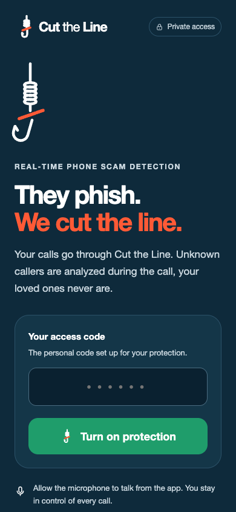

Entrée de l'app : le PIN ouvre la session et signe ensuite chaque appel au serveur.

## 02-recents-appels-recus

Onglet Récents : les derniers appels, leur provenance, et ceux qui ont été manqués.

## 03-favoris-proches-epingles

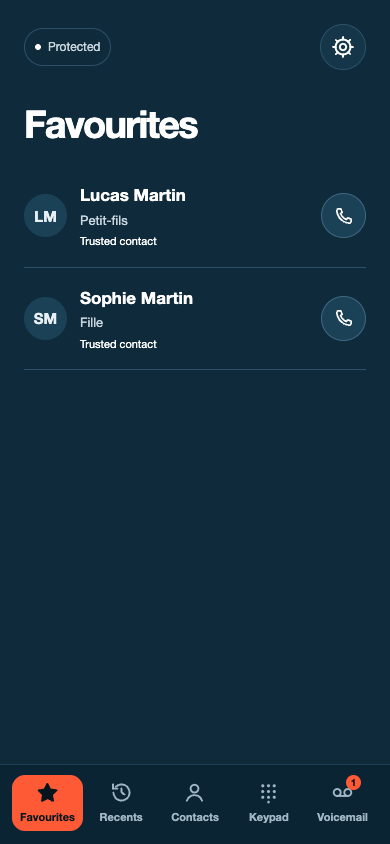

Onglet Favoris : les proches épinglés, appelables sans rien taper — l'écran de l'urgence.

## 04-reglages-etat-de-la-protection

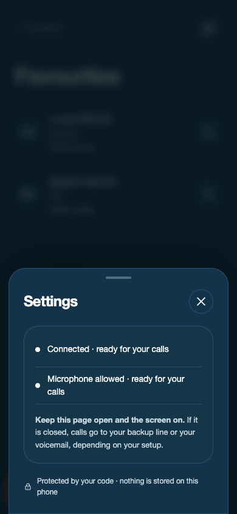

Feuille Réglages : l'état de la protection et les réglages, à un seul endroit.

## 05-contacts-carnet-d-adresses

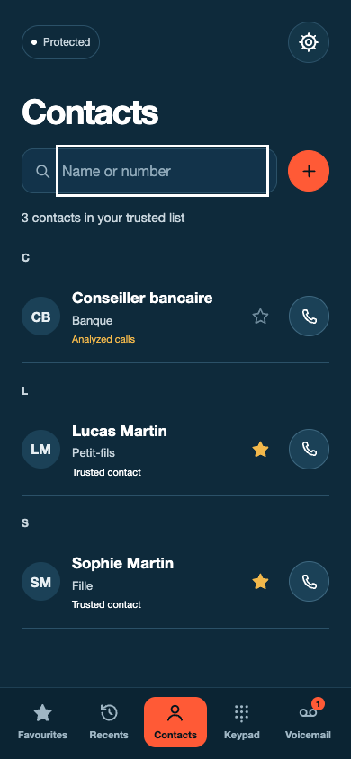

Onglet Contacts : le carnet, et pour chacun « contact de confiance » ou « appels analysés ».

## 06-clavier-numero-compose

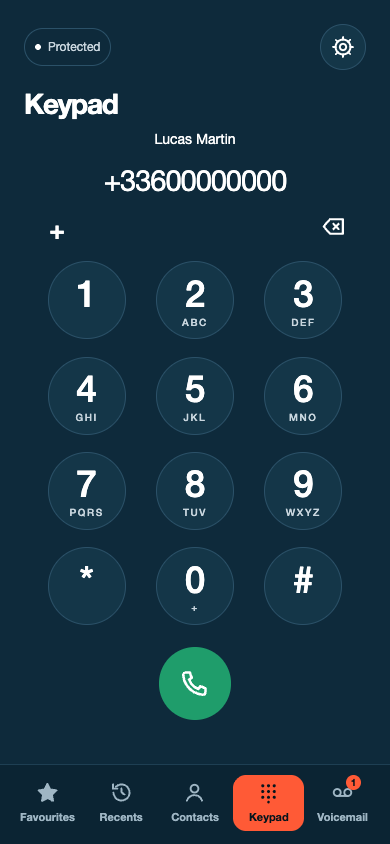

Onglet Clavier : le pavé tient dans l'écran, sans scroll, et rien ne s'écrit sous le bouton d'appel.

## 07-appel-sortant-non-analyse

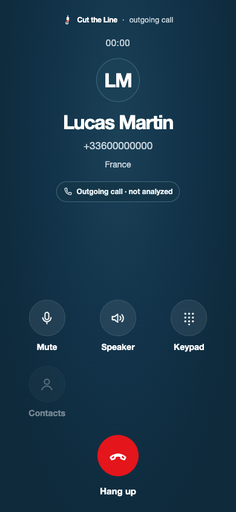

Appel sortant en cours : ni analysé ni enregistré — aucun score, pas de bouton Vérifier ni Attente.

## 08-messagerie-deux-messages

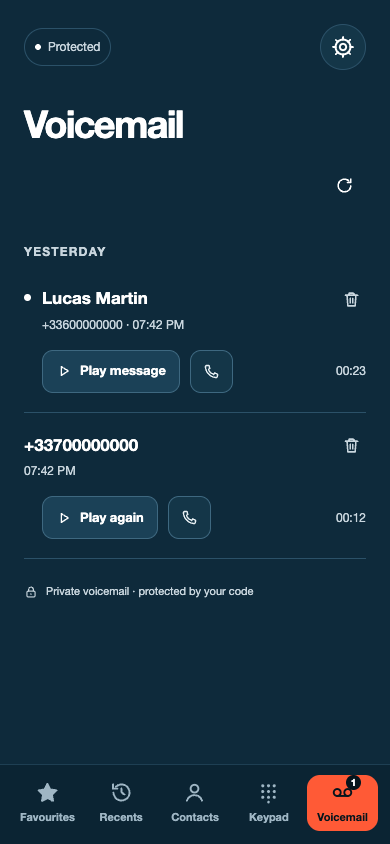

Onglet Messagerie : les messages déposés après le bip, avec leur état lu / non lu.

## 09-messagerie-ecoute-d-un-message

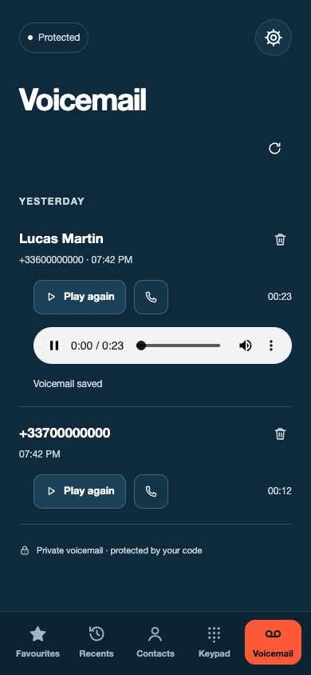

Écoute d'un message : l'audio arrive par une route protégée par le PIN, sans URL Twilio dans le navigateur.

## 10-messagerie-suppression-a-confirmer

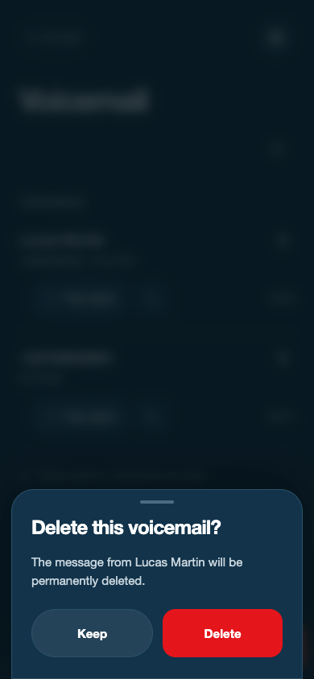

Supprimer un message demande une confirmation : l'audio distant part avec la ligne.

## 11-messagerie-aucun-message

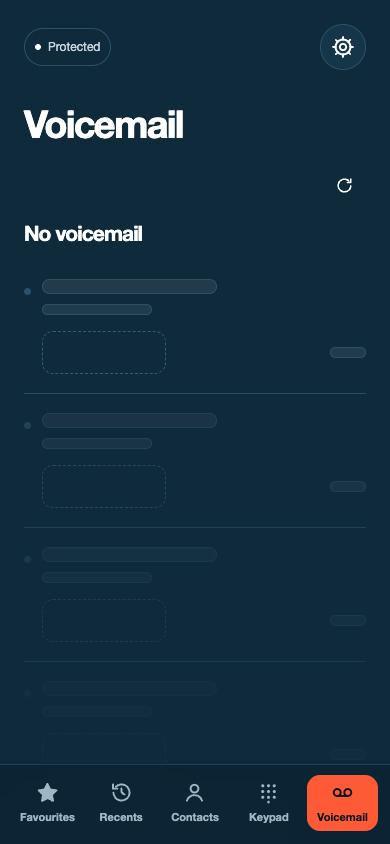

Messagerie vide : la boîte se lit comme vide, pas comme un chargement qui n'en finit pas.

## 12-appel-entrant-numero-inconnu

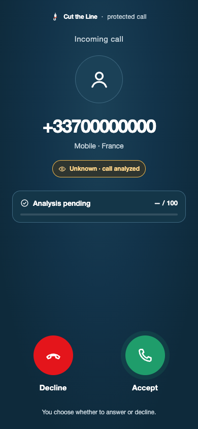

Appel entrant d'un numéro inconnu : le vrai numéro de l'appelant, sa provenance, et le bouton Vérifier.

## 13-appel-en-cours-vigilance-score-48

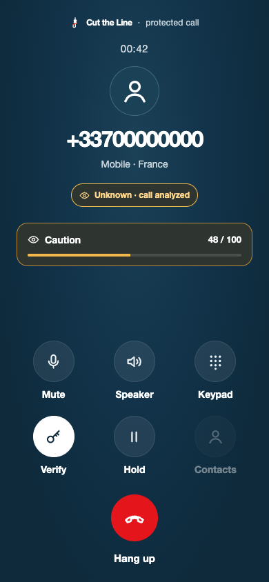

Appel analysé en cours, score 48 : vigilance. Le dashboard s'oriente, mais rien n'est encore audible.

## 14-appel-clavier-dtmf

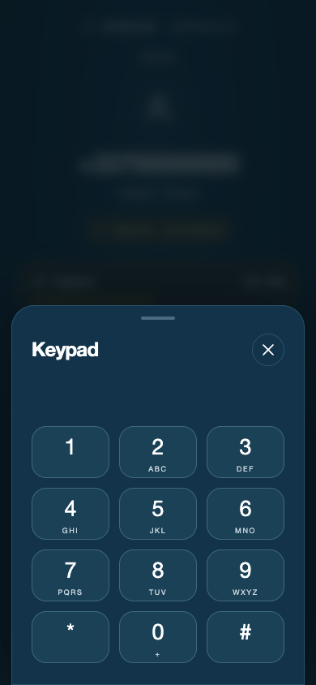

Clavier pendant l'appel : les touches partent en DTMF dans la conversation (serveurs vocaux).

## 15-appel-scammeur-en-attente

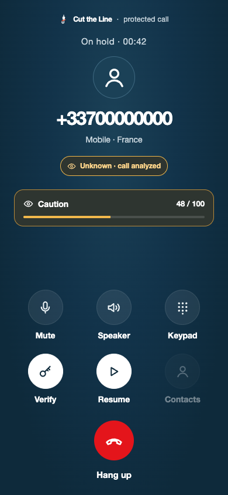

Mise en attente de l'appelant : il entend une musique, la personne protégée garde la main. Jamais de raccrochage automatique.

## 16-appel-alerte-arnaque-score-72

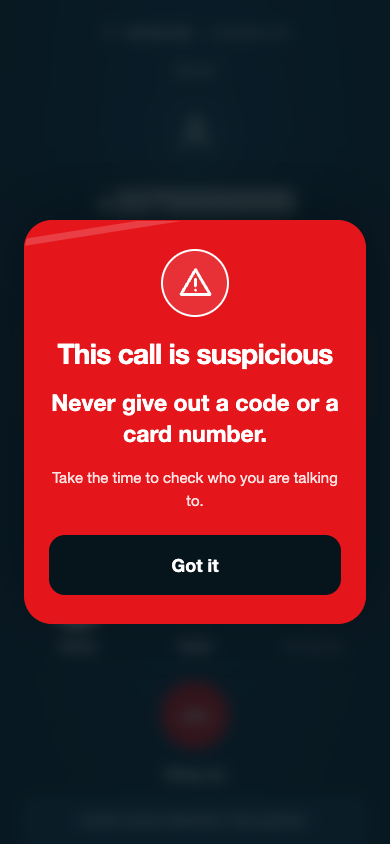

Score 72 : alerte. Annonce à la personne protégée seule, et SMS au vrai proche.

## 17-verification-code-a-4-chiffres

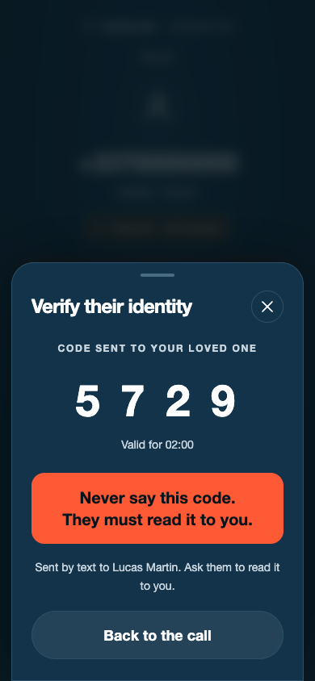

Vérification d'identité : le code part par SMS au numéro que le carnet connaît, jamais à celui qui appelle. « Ne dites jamais ce code. »

## 18-verification-echouee

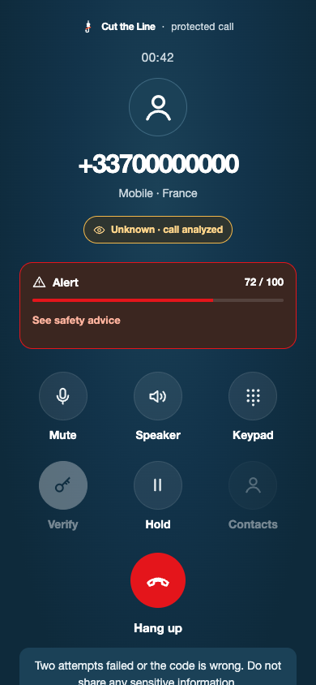

Le code n'a pas été lu : deux essais au maximum, et l'app le dit sans détour.

## 19-appel-termine

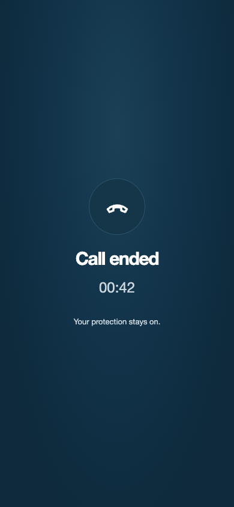

Fin d'appel : ce qui a été constaté pendant la conversation, une fois raccroché.

## 20-historique-liste-des-appels

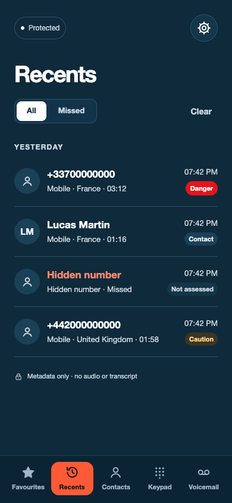

Historique : les appels conservés 30 jours, sans audio ni transcript en base.

## 21-historique-detail-d-un-appel-analyse

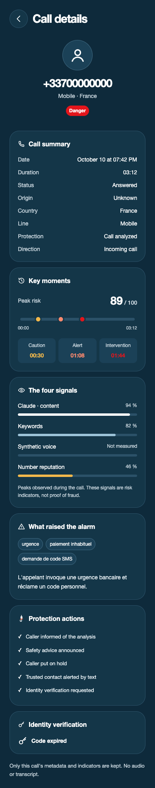

Détail d'un appel analysé, page entière : les 3 seuils franchis, les 4 signaux, les tactiques et la vérification.

## 22-historique-effacement-a-confirmer

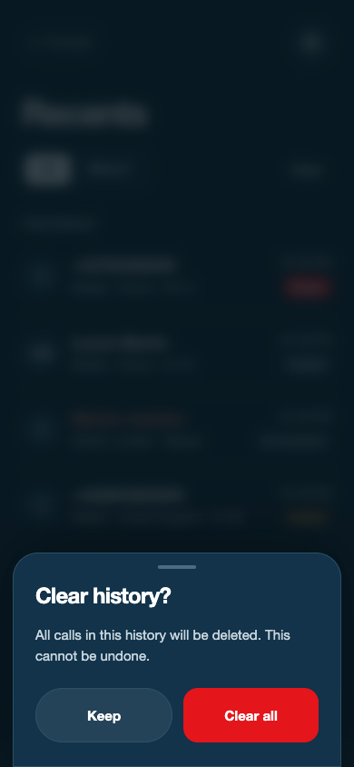

Effacer l'historique demande une confirmation, et couvre aussi l'appel en cours.

## 23-historique-aucun-appel

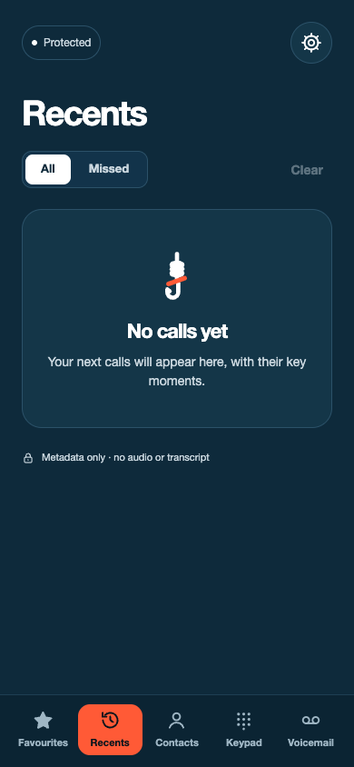

Historique vide après effacement : plus aucune métadonnée d'appel en base.

